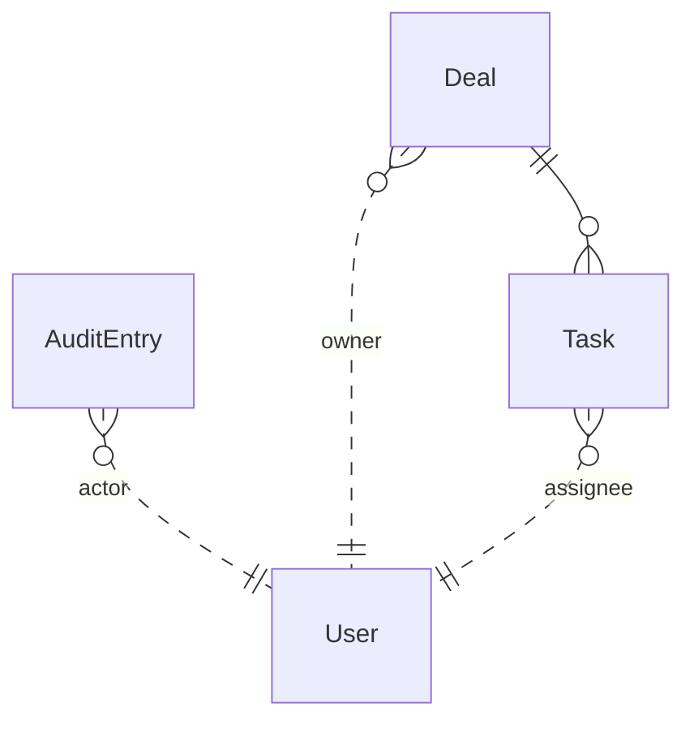

{/* Generated by `modelith render`. Do not edit by hand; edit the .modelith.yaml source and re-render. */}

# CRM

A small customer relationship manager used as the reference project for machinery. A Rep works deals through a pipeline and tracks tasks against them. An Admin can do everything a Rep can and can reopen lost deals. Every change is recorded in an append-only audit trail.

## Glossary

- **`Admin`** - A `User` with the admin role. May change any `Deal` or `Task` and may reopen a lost `Deal`.
- **`Assignee`** - The `User` a `Task` is assigned to.
- **`Owner`** - The `User` a `Deal` belongs to.
- **`Rep`** - A `User` with the rep role. Works the deals and tasks it owns.

## Enums

### `DealStage`

| Value | Definition |
| --- | --- |
| `Lead` | Unqualified opportunity. |
| `Qualified` | Confirmed fit and budget. |
| `Won` | Closed successfully; terminal. |
| `Lost` | Closed unsuccessfully; an Admin may reopen it. |

### `TaskStatus`

| Value | Definition |
| --- | --- |
| `Open` | Created, not started. |
| `InProgress` | Being worked. |
| `Done` | Completed; terminal. |
| `Cancelled` | Abandoned; terminal. |

### `UserRole`

| Value | Definition |
| --- | --- |
| `Admin` | May change any record. |
| `Rep` | May change the records it owns or is assigned. |

## Entities

### `AuditEntry`

A record that one `User` performed one action on one `Deal` or `Task`, with the outcome.

**Relationships**

- `User` - n:1 - referenced - actor

**Attributes**

| Name | Type | Description |
| --- | --- | --- |
| `action` | string |  |
| `subject` | string |  |
| `outcome` | string |  |
| `at` | timestamp |  |

**Invariants**

- **audit-append-only** - An `AuditEntry` is never updated or deleted.

### `Deal`

A sales opportunity owned by one `User`. Its stage follows the deal pipeline from lead to won or lost.

**Relationships**

- `User` - n:1 - referenced - owner
- `Task` - 1:n - owned

**Attributes**

| Name | Type | Description |
| --- | --- | --- |
| `title` | string |  |
| `stage` | DealStage |  |
| `amountCents` | integer |  |

**Actions**

- `create` - actor `Rep` - Create the `Deal` as a lead owned by the acting `User`.
- `qualify` - actor `Rep`; preserves deal-owner-or-admin-writes
- `win` - actor `Rep`; preserves deal-owner-or-admin-writes, deal-won-needs-amount
- `lose` - actor `Rep`; preserves deal-owner-or-admin-writes
- `reopen` - actor `Admin`; preserves deal-reopen-admin-only

**Invariants**

- **deal-owner-or-admin-writes** - Only the `Owner` of a `Deal` or an `Admin` changes it.
- **deal-won-needs-amount** - A `Deal` is won only when its amount is greater than zero.
- **deal-reopen-admin-only** - Only an Admin reopens a lost `Deal`.
- **deal-won-is-final** - A won `Deal` never changes stage again.

### `Task`

A unit of work attached to one `Deal` and assigned to one `User`.

**Relationships**

- `Deal` - n:1 - referenced
- `User` - n:1 - referenced - assignee

**Attributes**

| Name | Type | Description |
| --- | --- | --- |
| `title` | string |  |
| `status` | TaskStatus |  |

**Actions**

- `create` - actor `Rep` - Create the `Task` as open, assigned to the acting `User`.
- `start` - actor `Rep`; preserves task-assignee-or-admin-writes
- `complete` - actor `Rep`; preserves task-assignee-or-admin-writes
- `cancel` - actor `Rep`; preserves task-assignee-or-admin-writes, task-terminal-is-final

**Invariants**

- **task-assignee-or-admin-writes** - Only the `Assignee` of a `Task` or an `Admin` changes it.
- **task-terminal-is-final** - A done or cancelled `Task` never changes status again.

### `User`

A person who signs in and acts on deals and tasks. A `User` has exactly one role.

**Attributes**

| Name | Type | Description |
| --- | --- | --- |
| `email` | string |  |
| `role` | UserRole |  |

**Invariants**

- **user-email-unique** - No two `User` records share an email.

## Relationships

## Invariants

- **lifecycle-single-writer** - The stage of a `Deal` and the status of a `Task` change only along a transition of their machine, and only through the service's transition path.
- **every-change-audited** - Every stage change of a `Deal` and every status change of a `Task` writes exactly one `AuditEntry` in the same transaction.
- **refusals-are-audited** - Every refused action on a `Deal` or `Task` writes one `AuditEntry` with a refused outcome.

## Scenarios

### Rep qualifies and wins a deal

**Actors:** Rep

**Steps**

1. Rep creates a `Deal` with an amount; it is a lead.
2. Rep qualifies the `Deal`.
3. Rep wins the `Deal`; it is won and the audit trail shows three `AuditEntry` records.

**Invariants touched**

- **deal-won-needs-amount** - A `Deal` is won only when its amount is greater than zero.
- **every-change-audited** - Every stage change of a `Deal` and every status change of a `Task` writes exactly one `AuditEntry` in the same transaction.

### Rep cannot change another rep's deal

**Actors:** Rep

**Steps**

1. A first Rep creates a `Deal`.
2. A second `User` with the rep role tries to qualify it; the request is refused and the `Deal` is unchanged.

**Invariants touched**

- **deal-owner-or-admin-writes** - Only the `Owner` of a `Deal` or an `Admin` changes it.
- **refusals-are-audited** - Every refused action on a `Deal` or `Task` writes one `AuditEntry` with a refused outcome.

### Admin reopens a lost deal

**Actors:** Rep, Admin

**Steps**

1. Rep creates a `Deal` and loses it.
2. Rep tries to reopen it; the request is refused.
3. Admin reopens it; the `Deal` is a lead again.

**Invariants touched**

- **deal-reopen-admin-only** - Only an Admin reopens a lost `Deal`.

### Rep works a task to completion

**Actors:** Rep

**Steps**

1. Rep creates a `Task` on a `Deal`; it is open.
2. Rep starts the `Task`, then completes it.
3. Rep tries to cancel the completed `Task`; the request is refused.

**Invariants touched**

- **task-terminal-is-final** - A done or cancelled `Task` never changes status again.

